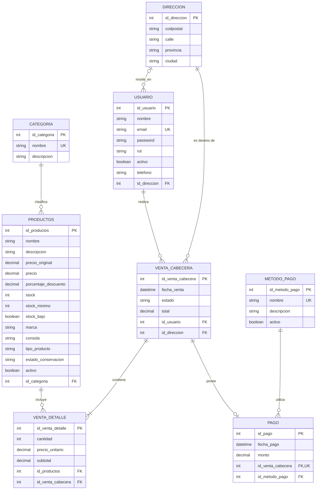

# Modelo Relacional (DER)

## Descripción General

El siguiente modelo relacional representa la estructura final de la base de datos del sistema de **Retro Games**, resultado del proceso de normalización (1FN, 2FN y 3FN) detallado en `normalizacion.md` e implementado físicamente en `sql/ddl/crear_bd.sql`. Está compuesto por **ocho entidades** relacionadas entre sí mediante claves foráneas (FK), que permiten gestionar el catálogo de productos, las categorías, los usuarios, las direcciones, el registro de ventas y los pagos con sus métodos.

> **Atributos almacenados y derivados:**
>
> - `precio_final` (productos) es un atributo derivado: se calcula y **no se almacena**. `precio_final = precio_original - (precio_original * porcentaje_descuento / 100)`.
> - `precio` (productos) **sí se almacena**: es el precio de venta vigente del producto, el que se copia a `venta_detalle.precio_unitario` al vender (RN-09).
> - `subtotal` (venta_detalle) **se almacena** y la base garantiza con un `CHECK` que `subtotal = cantidad * precio_unitario`.
> - `total` (venta_cabecera) **se almacena**. Debería ser la suma de los `subtotal` de los detalles, pero el esquema no lo verifica: lo mantienen los procedimientos almacenados (`sp_AgregarDetalleVenta`, `sp_RegistrarVentaTransaccional`).
> - `stock_bajo` (productos) **se almacena** y es derivado de `stock < stock_minimo`. Solo lo recalcula `sp_RegistrarVentaTransaccional`.

---

## Entidades y Atributos

### Tabla: `categoria`

| Campo | Tipo de Dato | Restricciones |
| :--- | :--- | :--- |
| **`id_categoria`** | INT IDENTITY | **Primary Key (PK)** |
| `nombre` | VARCHAR(100) | NOT NULL, UNIQUE |
| `descripcion` | VARCHAR(255) | |

### Tabla: `productos`

| Campo | Tipo de Dato | Restricciones |
| :--- | :--- | :--- |
| **`id_productos`** | INT IDENTITY | **Primary Key (PK)** |
| `nombre` | VARCHAR(150) | NOT NULL |
| `descripcion` | VARCHAR(500) | |
| `precio_original` | DECIMAL(10,2) | Opcional; si se informa, mayor a 0 |
| `precio` | DECIMAL(10,2) | NOT NULL, mayor a 0 |
| `porcentaje_descuento` | DECIMAL(5,2) | Opcional; entre 0 y 100 |
| `stock` | INT | Opcional; mayor o igual a 0; por defecto 0 |
| `stock_minimo` | INT | NOT NULL; mayor o igual a 0; por defecto 5 (RN-07) |
| `stock_bajo` | BIT | Por defecto 0 |
| `marca` | VARCHAR(100) | |
| `consola` | VARCHAR(100) | |
| `tipo_producto` | VARCHAR(100) | |
| `estado_conservacion` | VARCHAR(20) | NOT NULL; solo `NUEVO`, `USADO` o `EN_CAJA` (RN-04) |
| `activo` | BIT | Por defecto 1 (baja lógica) |
| `id_categoria` | INT | **Foreign Key (FK)** -> referencia a `categoria`, NOT NULL |

### Tabla: `direccion`

| Campo | Tipo de Dato | Restricciones |
| :--- | :--- | :--- |
| **`id_direccion`** | INT IDENTITY | **Primary Key (PK)** |
| `codpostal` | VARCHAR(10) | |
| `calle` | VARCHAR(150) | |
| `provincia` | VARCHAR(100) | |
| `ciudad` | VARCHAR(100) | |

### Tabla: `usuario`

| Campo | Tipo de Dato | Restricciones |
| :--- | :--- | :--- |
| **`id_usuario`** | INT IDENTITY | **Primary Key (PK)** |
| `nombre` | VARCHAR(100) | NOT NULL |
| `email` | VARCHAR(150) | NOT NULL, UNIQUE, formato válido (RN-11) |
| `password` | VARCHAR(255) | NOT NULL (largo previsto para un hash) |
| `rol` | VARCHAR(20) | NOT NULL; solo `ADMIN` o `CLIENTE`; por defecto `CLIENTE` |
| `activo` | BIT | Por defecto 1 (baja lógica) |
| `telefono` | VARCHAR(30) | |
| `id_direccion` | INT | **Foreign Key (FK)** -> referencia a `direccion` (opcional) |

### Tabla: `venta_cabecera`

| Campo | Tipo de Dato | Restricciones |
| :--- | :--- | :--- |
| **`id_venta_cabecera`** | INT IDENTITY | **Primary Key (PK)** |
| `fecha_venta` | DATETIME | NOT NULL; por defecto la fecha y hora actuales |
| `estado` | VARCHAR(20) | NOT NULL; `PENDIENTE`, `PAGADA`, `ENVIADA`, `ENTREGADA`, `CANCELADA` o `CARRITO`; por defecto `PENDIENTE` (RN-12) |
| `total` | DECIMAL(12,2) | NOT NULL; mayor o igual a 0 |
| `id_usuario` | INT | **Foreign Key (FK)** -> referencia a `usuario`, NOT NULL |
| `id_direccion` | INT | **Foreign Key (FK)** -> referencia a `direccion`, NOT NULL |

### Tabla: `venta_detalle`

| Campo | Tipo de Dato | Restricciones |
| :--- | :--- | :--- |
| **`id_venta_detalle`** | INT IDENTITY | **Primary Key (PK)** |
| `cantidad` | INT | NOT NULL, mayor a 0 |
| `precio_unitario` | DECIMAL(10,2) | NOT NULL, mayor a 0 (precio congelado, RN-09) |
| `subtotal` | DECIMAL(12,2) | NOT NULL, mayor a 0; debe ser igual a `cantidad * precio_unitario` |
| `id_productos` | INT | **Foreign Key (FK)** -> referencia a `productos`, NOT NULL |
| `id_venta_cabecera` | INT | **Foreign Key (FK)** -> referencia a `venta_cabecera`, NOT NULL |

### Tabla: `pago`

| Campo | Tipo de Dato | Restricciones |
| :--- | :--- | :--- |
| **`id_pago`** | INT IDENTITY | **Primary Key (PK)** |
| `fecha_pago` | DATETIME | NOT NULL; por defecto la fecha y hora actuales |
| `monto` | DECIMAL(12,2) | NOT NULL, mayor a 0 |
| `id_venta_cabecera` | INT | **Foreign Key (FK)** -> referencia a `venta_cabecera`, NOT NULL, UNIQUE |
| `id_metodo_pago` | INT | **Foreign Key (FK)** -> referencia a `metodo_pago`, NOT NULL |

### Tabla: `metodo_pago`

| Campo | Tipo de Dato | Restricciones |
| :--- | :--- | :--- |
| **`id_metodo_pago`** | INT IDENTITY | **Primary Key (PK)** |
| `nombre` | VARCHAR(50) | NOT NULL, UNIQUE |
| `descripcion` | VARCHAR(255) | |
| `activo` | BIT | NOT NULL; 1 = método habilitado por la administración (RN-10); por defecto 0: un método nuevo nace deshabilitado hasta que se lo autorice |

---

## Relaciones y Cardinalidades

| Relación | Cardinalidad | Descripción |
| :--- | :--- | :--- |
| `categoria` → `productos` | **1..N** | Una categoría puede agrupar muchos productos; cada producto pertenece a una única categoría. |
| `productos` → `venta_detalle` | **1..N** | Un producto puede aparecer en muchos detalles de venta; cada detalle referencia a un único producto. |
| `venta_cabecera` → `venta_detalle` | **1..N** | Una venta (cabecera) puede tener muchos ítems de detalle; cada detalle pertenece a una única venta. Que toda venta tenga al menos un ítem es una regla de negocio que el esquema no fuerza. |
| `usuario` → `venta_cabecera` | **1..N** | Un usuario puede realizar muchas ventas; cada venta es realizada por un único usuario. |
| `direccion` → `venta_cabecera` | **1..N** | Una dirección puede usarse como destino de muchas ventas; cada venta tiene una única dirección de entrega. |
| `direccion` → `usuario` | **1..N** (opcional) | Una dirección puede estar asociada a varios usuarios; un usuario tiene como máximo una dirección propia. |
| `venta_cabecera` → `pago` | **0..1** | Una venta posee como máximo un pago (`UNIQUE` sobre `id_venta_cabecera`); las ventas en `CARRITO` o `PENDIENTE` todavía no tienen pago. Cada pago corresponde a una única venta. |
| `metodo_pago` → `pago` | **1..N** | Un método de pago puede utilizarse en muchos pagos; cada pago utiliza un único método. |

### Acciones referenciales

| Clave foránea | Al borrar el registro padre |
| :--- | :--- |
| `productos` → `categoria` | `NO ACTION`: no se borra una categoría con productos |
| `usuario` → `direccion` | `SET NULL`: el usuario queda sin dirección |
| `venta_cabecera` → `usuario` / `direccion` | `NO ACTION`: se conserva el historial |
| `venta_detalle` → `productos` | `NO ACTION`: no se borra un producto vendido |
| `venta_detalle` → `venta_cabecera` | `CASCADE`: al borrar la venta se borran sus ítems |
| `pago` → `venta_cabecera` / `metodo_pago` | `NO ACTION`: el pago es un registro contable |

---

## Diagrama Entidad-Relación

